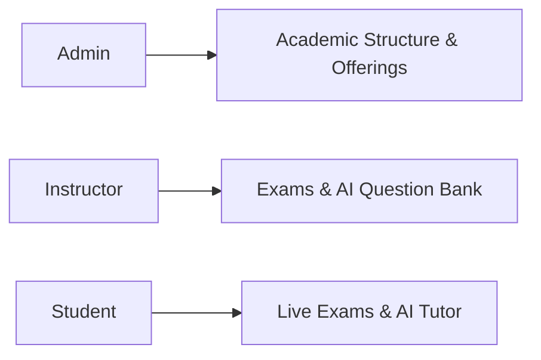

# University Exam Management System (UEMS)

A multi-role academic examination and assessment platform built with **Laravel 11/12** and **Vue 3 + TypeScript**, featuring generative AI question authoring, proctored digital exams, and an interactive practice tutor.

---

## Overview



---

## Core Features

- **Granular RBAC & Workspace Switching**: 8-tier role hierarchy (`super_admin` to `student`). Multi-role users switch workspaces instantly in the topbar without re-authenticating. Standard instructors are scoped to their assigned courses, while department heads retain departmental oversight.
- **AI Question Generator**: Creates MCQs, True/False, Short Answer, and Essay questions via Prism PHP (Gemini, Claude, OpenAI). Supports both **Topic / Objective** mode and **Lecture Notes** mode with context-aware deduplication.
- **Socratic AI Practice Tutor**: Students practice self-paced exams with instant evaluation and an interactive AI tutor that explains concepts and distractor options without leaking direct solutions.
- **Proctored Examination Canvas**: Distraction-free exam mode with live countdown timers, question navigation palette, and offline local memory resilience.
- **Dual-Mode Grading**: Instant automated grading for objective questions paired with rubric-based manual grading and double-blind verification for subjective answers.
- **Dynamic Theming**: Oxford Crimson, Forest Green, and Slate Amber themes with complete dark and light mode support.

---

## Role & Permission Model

| Role | Scope & Permissions |
| :--- | :--- |
| **Super Admin** | Platform-level management, global tenants, and system-wide settings. |
| **University / College Admin** | Institutional hierarchy (colleges, departments, programs, curricula, semesters). |
| **Department Head** | Course offerings approval, instructor staffing, and exam moderation. |
| **Instructor** | Course question bank authoring (manual or AI), exam assembly, and grading. |
| **Student** | Taking proctored exams, viewing published results, and practice hub sessions. |

*Multi-role faculty members (e.g., Department Head + Course Instructor) switch between Admin and Instructor views dynamically in one click.*

---

## Generative AI Engine

Powered by [Prism PHP](https://github.com/prism-php/prism) for unified model abstraction:

1. **AI Question Authoring**:
   - **Topic Mode**: Generates questions from learning objectives and Bloom's taxonomy levels.
   - **Notes Mode**: Derives questions strictly grounded in uploaded lecture notes or slides.
   - **Review Deck**: Visual deck allowing instructors to inspect, edit, or discard generated questions before attaching them to an exam.
2. **Practice Tutor**:
   - Real-time guidance (`QuestionGuidanceJob`) that breaks down complex questions and distractor choices socratically.

---

## Demo Accounts

All accounts share the default password: `password`

| Role | Email |
| :--- | :--- |
| **Super Admin** | `superadmin@uems.test` |
| **Department Head** | `depthead.se@uems.test` |
| **Lead Instructor** | `instructor.se1@uems.test` |
| **Multi-Role (Dept Head + Instructor)** | `multirole@uems.test` |
| **Student** | `student.se1@uems.test` |

---

## Quickstart

### 1. Backend Setup
```bash
cd backend
composer install
cp .env.example .env && php artisan key:generate

# Configure DB credentials and AI key (GEMINI_API_KEY or OPENAI_API_KEY) in .env
php artisan migrate:fresh --seed
php artisan queue:listen --tries=1 --timeout=0 &
php artisan serve
```

### 2. Frontend Setup
```bash
cd frontend
npm install
npm run dev
```

- Frontend: `http://localhost:5173`
- Backend API: `http://localhost:8000`
- Interactive OpenAPI Docs: `http://localhost:8000/docs/api`

---

## Verification & Tests

```bash
# Backend Pest test suite
cd backend && ./vendor/bin/pest

# Code style formatting
cd backend && ./vendor/bin/pint --test

# Frontend production build
cd frontend && npm run build-only
```

---

## License

[MIT](LICENSE)
