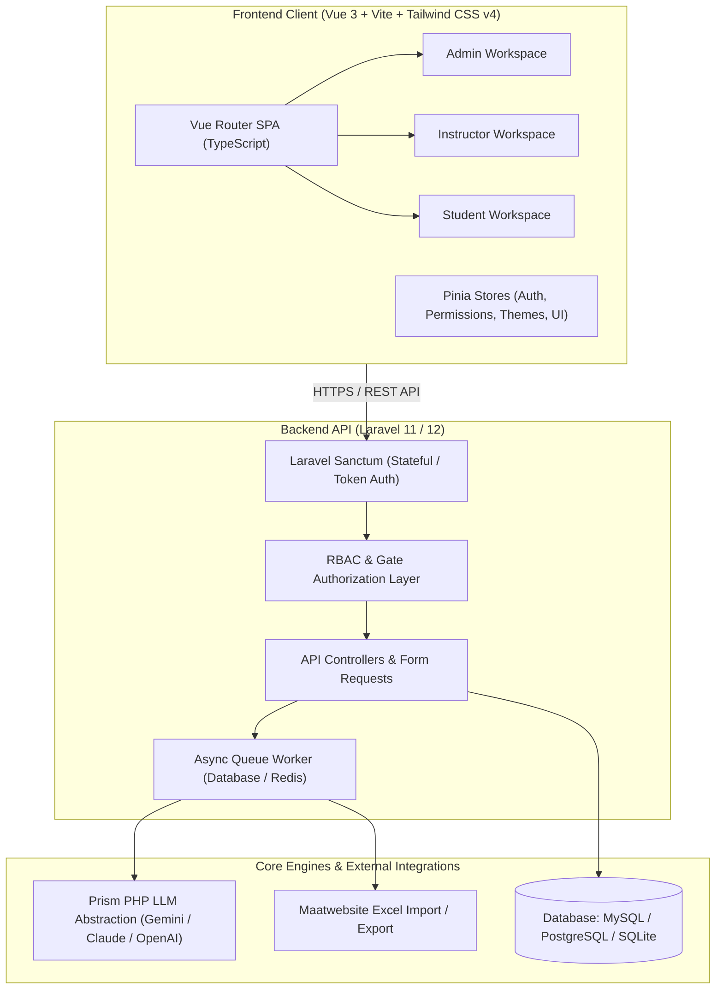

# 🎓 University Exam Management System (UEMS)

[](https://www.php.net/)
[](https://laravel.com/)
[-4FC08D?style=flat-square&logo=vue.js&logoColor=white)](https://vuejs.org/)
[](https://www.typescriptlang.org/)
[](https://tailwindcss.com/)
[-00D26A?style=flat-square&logo=php&logoColor=white)](https://pestphp.com/)
[](LICENSE)

An enterprise, multi-tenant academic assessment and examination platform designed for universities and higher education institutions. Built with a **Laravel REST API** and a **Vue 3 + TypeScript SPA**, UEMS unifies curriculum governance, generative AI question authoring, proctored digital exams, double-blind grading, and an interactive AI Socratic practice tutor.

---

## 📑 Table of Contents

- [Executive Overview](#-executive-overview)
- [System Architecture](#-system-architecture)
- [Deep Dive: Permission & Role-Based Access Control (RBAC)](#-deep-dive-permission--role-based-access-control-rbac)
  - [Role Hierarchy](#role-hierarchy)
  - [Granular Permission Domains](#granular-permission-domains)
  - [Multi-Role & Workspace Context Switching](#multi-role--workspace-context-switching)
  - [Frontend Action & Route Guards](#frontend-action--route-guards)
- [Deep Dive: Generative AI Assessment Engine](#-deep-dive-generative-ai-assessment-engine)
  - [LLM Abstraction via Prism PHP](#llm-abstraction-via-prism-php)
  - [AI Question Generator (Topics & Lecture Notes)](#ai-question-generator-topics--lecture-notes)
  - [Deduplication & Schema Validation](#deduplication--schema-validation)
  - [Interactive Review Deck](#interactive-review-deck)
  - [Socratic AI Practice Tutor](#socratic-ai-practice-tutor)
- [Core Application Portals](#-core-application-portals)
  - [Admin Portal](#1-administrative-portal)
  - [Instructor Portal](#2-instructor-portal)
  - [Student Portal](#3-student-portal)
- [Theme Engine](#-theme-engine)
- [Default Seeded Accounts](#-default-seeded-accounts)
- [Installation & Quickstart](#-installation--quickstart)
- [Testing & Quality Assurance](#-testing--quality-assurance)

---

## 🌟 Executive Overview

University examinations require rigorous institutional hierarchy, uncompromised test integrity, and strict separation of duties. Traditional LMS platforms often treat exams as simple quizzes. UEMS is purpose-built to manage the full academic assessment lifecycle:

1. **Curriculum Governance**: Mapping universities down through colleges, departments, degree programs, semesters, and course offerings with faculty staffing capacity.
2. **Pedagogical Integrity**: Dual-mode question authoring (manual taxonomy-based + LLM generative workflows with strict deduplication).
3. **Resilient Exam Taking**: Distraction-free, offline-resilient exam sitting interface with live countdown alerts, navigation palettes, and auto-saving mechanisms.
4. **Verifiable Evaluation**: Automated instant grading for objective questions paired with double-blind verification and rubric manual grading for subjective answers.
5. **Self-Paced Mastery**: Student Practice Hub with instant feedback and an AI Socratic tutor that explains conceptual principles without leaking direct exam solutions.

---

## 🏛️ System Architecture



---

## 🔐 Deep Dive: Permission & Role-Based Access Control (RBAC)

The RBAC system in UEMS is built for strict university hierarchies where users frequently occupy multiple responsibilities simultaneously (e.g., a Professor who is also a Department Head or College Coordinator).

### Role Hierarchy

The platform defines eight distinct role tiers with defined boundaries:

| Role Name | Authority Scope | Primary Responsibilities |
| :--- | :--- | :--- |
| `super_admin` | Global / Platform-wide | System health, tenant provisioning, cross-institutional governance. |
| `university_admin` | University Level | Academic structures, colleges, departments, semester configurations. |
| `college_admin` | College Level | Managing departments, programs, and curricula within a college. |
| `dept_head` | Department Level | Course offerings approval, faculty assignment, curriculum audits. |
| `exam_admin` | Examination Office | Scheduling exam sessions, hall assignments, and exam lifecycle rules. |
| `lead_instructor` | Course Coordinator | Exam assembly, question pool moderation, official exam submissions. |
| `instructor` | Section Instructor | Question authoring, section grading, roster review. |
| `student` | Candidate | Taking proctored exams, viewing published results, practice hub. |

### Granular Permission Domains

Rather than relying on coarse role checks, the backend enforces **120+ granular permissions** divided into functional domains:

- **Academic Structure**: `university.*`, `college.*`, `department.*`, `program.*`, `course.*`, `curriculum.*`, `semester.*`, `section.*`
- **Staffing & Faculty**: `instructor.*`, `course_offering.assign_instructor`, `course_offering.approve`
- **Assessment Management**: `question.create`, `question.view_all`, `question.flag`, `exam.create`, `exam.schedule`, `exam.publish`
- **Grading & Results**: `grade.autograde`, `grade.create`, `grade.verify`, `grade.publish`, `result.view_own`, `result.export`
- **Identity & Access**: `user.create`, `role.assign`, `permission.view`, `import.view`

### Multi-Role & Workspace Context Switching

In many institutions, a faculty member acts as an **Instructor** for their own courses while simultaneously holding **Department Head** administrative duties. 

- **Unified Identity**: A user authenticates once via `POST /api/auth/login`.
- **Role Detection**: The backend returns all assigned roles and active permission sets in the user session.
- **Dynamic Workspace Switcher**: The top navigation bar features an instant workspace switcher (`Admin`, `Instructor`, `Student`), letting the user seamlessly transition their active UI context without re-authenticating.
- **API Guarding**: Controllers check `$user->hasPermission(...)` and apply Eloquent scopes (such as `Question::forUser($user)` which limits standard instructors to their assigned course offerings while allowing department heads broader oversight).

### Frontend Action & Route Guards

Permissions are enforced at three defense layers in the Vue application:

1. **Route Level (`router/guards.ts`)**: Navigation to `/admin/*`, `/instructor/*`, or `/student/*` verifies role membership and required route permissions (`meta.permissions`).
2. **Component Level (`usePermissionsStore`)**: Buttons, action menus, and edit triggers dynamically display or disable depending on `hasPermission(...)` or `hasAnyPermission(...)`.
3. **API Level (Laravel Policies & Requests)**: Unauthorized requests are rejected with `403 Forbidden` and handled gracefully by the global error interceptor.

---

## 🤖 Deep Dive: Generative AI Assessment Engine

UEMS incorporates generative AI as a first-class assessment tool, combining LLM creativity with deterministic schema enforcement and pedagogical safety.

### LLM Abstraction via Prism PHP

The AI engine uses **[Prism PHP](https://github.com/prism-php/prism)**, providing a clean abstraction layer over modern AI models:
- **Default Provider**: Google Gemini (`gemini-2.5-flash` / `gemini-1.5-pro`).
- **Supported Providers**: Anthropic Claude, OpenAI GPT-4o, DeepSeek, Mistral, and local Ollama instances.
- **Provider Switching**: Swapping AI backends requires only updating `config/prism.php` and `.env` credentials—no service layer refactoring is needed.

### AI Question Generator (Topics & Lecture Notes)

Instructors can generate high-quality question batches via two distinct modalities:

```
┌────────────────────────────────────────────────────────┐
│                   AI Generation Modes                  │
├───────────────────────────┬────────────────────────────┤
│   Topic / Objective Mode  │  Lecture Notes / Text Mode │
├───────────────────────────┼────────────────────────────┤
│ Generates questions from  │ Ingests raw lecture slides,│
│ learning objectives, key  │ text excerpts, or chapters.│
│ concepts, or topics.      │ Enforces strict grounding: │
│ Ideal for curriculum-wide │ questions must be derived  │
│ diagnostic tests.         │ ONLY from provided notes.  │
└───────────────────────────┴────────────────────────────┘
```

**Parameters Configured by Instructor**:
- **Question Types**: Multiple Choice (MCQ), True/False, Short Answer, Essay.
- **Difficulty Levels**: `Easy`, `Medium`, `Hard`.
- **Batch Count**: Exact number of questions (e.g. 5, 10, 15).

### Deduplication & Schema Validation

To prevent LLMs from generating duplicate questions or hallucinating invalid structures:

1. **Context Deduplication**: The system extracts existing question texts in the course's question bank and includes them in the context payload, prompting the model to generate novel assessments.
2. **Deterministic Schema Enforcement**:
   ```php
   Prism::structured()
       ->using(Provider::Gemini, 'gemini-2.5-flash')
       ->withSchema($this->questionsListSchema())
       ->withSystemPrompt(...)
       ->withPrompt(...)
       ->asStructured();
   ```
3. **Validation Guardrails (`QuestionValidator`)**:
   - For MCQs: Ensures at least 2 distinct option strings exist and `correct_answer` strictly matches one of the options.
   - For True/False: Ensures options are strictly `['True', 'False']`.
   - For Essay/Short Answer: Validates minimum character requirements and marks rubrics.

### Interactive Review Deck

Generative AI output is **never** blindly inserted into the live question bank:
- Generated questions are dispatched as background jobs (`GenerateQuestions`) and stored in `GeneratedQuestionsHistory`.
- The instructor reviews a visual **Review Deck**: inspecting stems, options, and difficulty badges.
- Instructors can delete individual weak questions, tweak prompt parameters, or click **"Confirm & Attach"** to seamlessly commit questions into the course bank or directly to an active exam.

### Socratic AI Practice Tutor

In the Student Practice Hub, students can practice self-paced exams. When reviewing questions, students have access to an **Interactive AI Tutor**:
- **Socratic Instruction**: The tutor prompt explicitly forbids giving away the correct answer. Instead, it explains underlying concepts, breaks down why distractor options are incorrect, and provides guidance.
- **Context Grounding**: The background job (`QuestionGuidanceJob`) injects the question stem, student's selected answer, and option list into the prompt, allowing students to ask contextual follow-ups (e.g., *"Why isn't option B valid in virtual memory segmentation?"*).

---

## 🖥️ Core Application Portals

### 1. Administrative Portal
- **Executive Dashboard**: Unified KPI deck (Colleges, Departments, Programs, Courses, Instructors, Users), operational staffing coverage meter, offering pipeline readiness, and urgent triage queue.
- **Institutional Structure**: Manage academic hierarchy, curricula, course codes, and section capacities.
- **Course Offerings Lifecycle**: Term planning, section load balancing, instructor assignments, and approval workflows.
- **Bulk Data Imports**: Multi-sheet Excel and CSV imports for students, faculty, courses, and questions with real-time validation feedback.
- **Access Control Directory**: Manage users, assign roles, inspect active permissions, and reset credentials.

### 2. Instructor Portal
- **Course Offering Hub**: Centralized view of assigned sections, student rosters, and active exams.
- **Question Bank**: Filterable question repository categorized by course, chapter, type, and difficulty.
- **AI Question Authoring Studio**: Topic & Lecture-Notes AI generation modal with review deck.
- **Exam Builder**: Create exams, assemble questions (randomized or curated sets), define time windows, configure duration, and track auto-synced total marks.
- **Grading Queue & Submissions**:
  - Auto-grading engine for objective answers.
  - Manual grading modal with numerical mark controls, question-level feedback, and double-blind verification before publishing.

### 3. Student Portal
- **Examination Canvas**:
  - Fullscreen distraction-free mode.
  - Live countdown timer with 5-minute critical alert states.
  - 4-column compact question palette with filter tabs (`All`, `Unanswered`, `Flagged`).
  - Auto-save with unsaved edits detection and offline local memory resilience.
  - Pre-submission confirmation summary (answered vs. unanswered count).
- **Self-Paced Practice Hub**:
  - Generate practice sessions with instant evaluation.
  - Detailed pedagogical explanations for each option.
  - Interactive Socratic AI guidance with multi-turn follow-up queries.
- **Gradebook & Results**:
  - Summary cards of completed exams, published marks, and breakdown analysis.

---

## 🎨 Theme Engine

UEMS features an institutional theme engine with persistent user preference storage:

| Theme Name | Primary Accent | Visual Identity |
| :--- | :--- | :--- |
| **Oxford Crimson** | Deep Crimson (`#800020`) | Traditional, authoritative university aesthetic. |
| **Forest Green** | Emerald Jade (`#1B4332`) | Calm, focused natural academic tone. |
| **Slate Amber** | Charcoal & Warm Amber | Modern, technical engineering aesthetic. |

*Full Light Mode and Dark Mode support across all themes with semantic color tokens (`bg-bg`, `bg-surface`, `border-border`, `text-text`, `text-accent`).*

---

## 🔑 Default Seeded Accounts

The database seeder provisions a comprehensive test environment. All accounts share the default password:

> **Default Password for all seeded users**: `password`

| Role | Email Address | Description |
| :--- | :--- | :--- |
| **Super Admin** | `superadmin@uems.test` | Full institutional platform access. |
| **University Admin** | `universityadmin@uems.test` | University structure & term management. |
| **College Admin** | `collegeadmin@uems.test` | Engineering college administrator. |
| **Department Head** | `depthead.se@uems.test` | Software Engineering department head. |
| **Lead Instructor** | `instructor.se1@uems.test` | Course coordinator for Software Engineering. |
| **Instructor** | `instructor.se2@uems.test` | Teaching faculty & grader. |
| **Multi-Role User** | `multirole@uems.test` | Holds both `dept_head` and `instructor` roles. |
| **Student** | `student.se1@uems.test` | Enrolled student candidate. |

---

## 🚀 Installation & Quickstart

### Prerequisites
- **PHP**: `^8.3` (with `pdo`, `mbstring`, `openssl`, `curl`, `xml`, `gd` extensions)
- **Composer**: `^2.5`
- **Node.js**: `^22.18.0` or `>=24.12.0`
- **Database**: MySQL `^8.0`, PostgreSQL `^15`, or SQLite

### 1. Clone & Backend Setup
```bash
# Clone the repository
git clone https://github.com/amirlogs/exam-management-system.git
cd exam-management-system/backend

# Install PHP dependencies
composer install

# Configure environment
cp .env.example .env
php artisan key:generate

# Set up your database in .env (or use SQLite):
# DB_CONNECTION=mysql
# DB_HOST=127.0.0.1
# DB_PORT=3306
# DB_DATABASE=uems_db
# DB_USERNAME=root
# DB_PASSWORD=secret

# Add your AI credentials in .env:
# GEMINI_API_KEY=your_gemini_api_key_here
# or OPENAI_API_KEY=your_openai_api_key_here

# Run database migrations and seed all roles & test users
php artisan migrate:fresh --seed
```

### 2. Frontend Setup
```bash
cd ../frontend

# Install Node dependencies
npm install

# Start Vite development server
npm run dev
```

### 3. Background Queue Worker (Required for AI features)
```bash
# In the backend directory:
php artisan queue:listen --tries=1 --timeout=0
```

*The frontend application will be running at `http://localhost:5173` and the backend API at `http://localhost:8000`.*

---

## 🧪 Testing & Quality Assurance

### Backend Tests (Pest PHP)
```bash
cd backend
./vendor/bin/pest
```
*Executes unit and feature test suites covering exam lifecycle, totals calculations, grading accuracy, and RBAC authorization.*

### Code Style (Laravel Pint)
```bash
./vendor/bin/pint --test
```

### Frontend Typecheck & Production Build
```bash
cd frontend

# Verify TypeScript types
npm run type-check

# Production build
npm run build
```

---

## 📄 API Documentation

Automated OpenAPI / Swagger interactive documentation is generated via **Dedoc Scramble**:
- Navigate to: `http://localhost:8000/docs/api` (when running local server).

---

## 📜 License

This project is licensed under the **MIT License** — see the [LICENSE](LICENSE) file for details.
